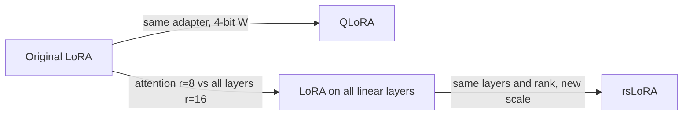
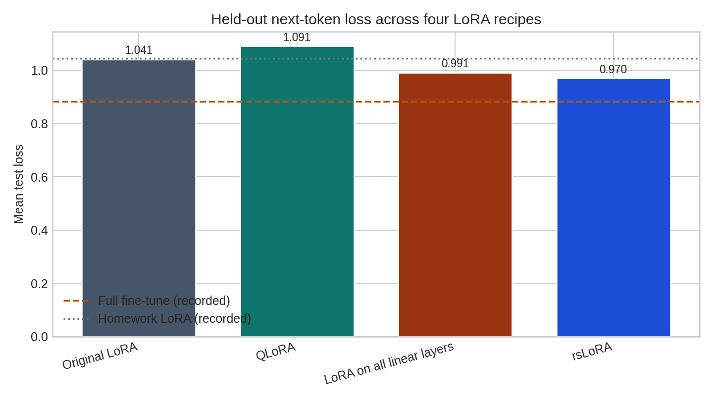
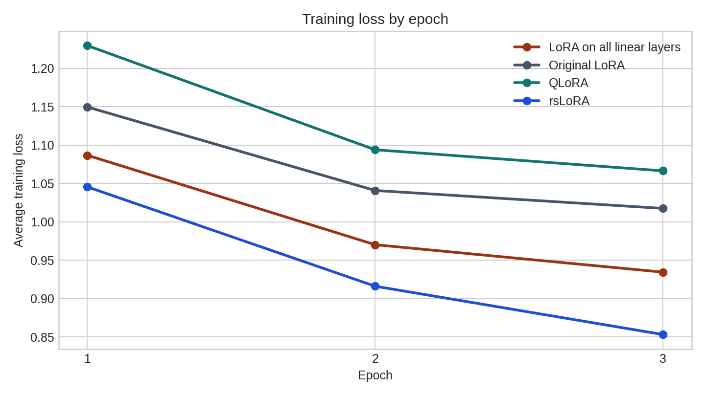
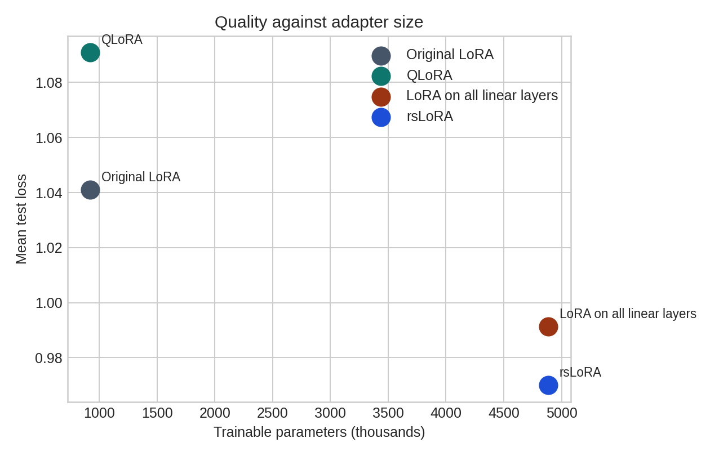
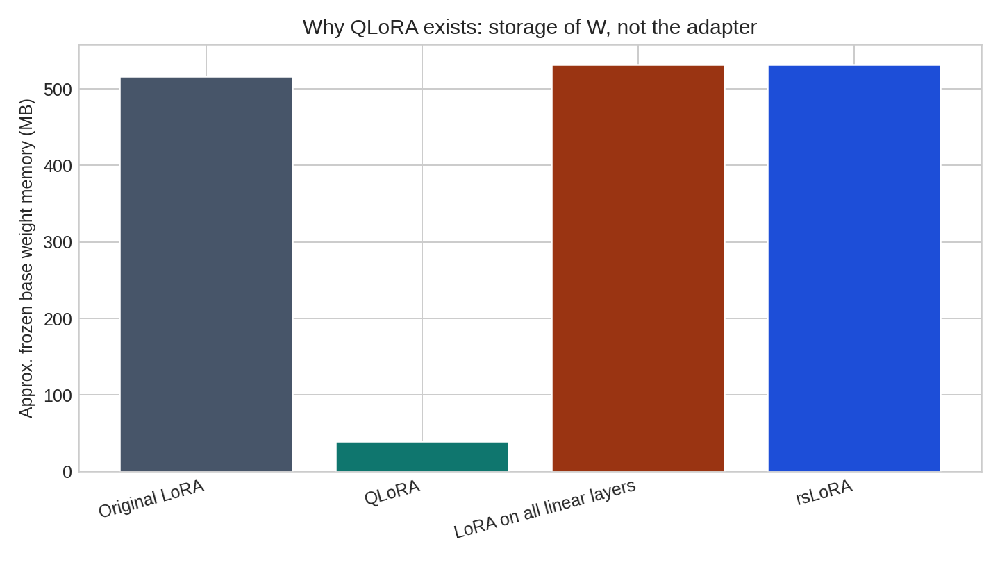

# LoRATune: instruction fine-tuning with low-rank adapters

LoRATune is a short lesson on Low-Rank Adaptation, then a controlled comparison of four PEFT recipes that people actually ship. The lesson reviews why a fine-tune can be written as a small update, what rank means, and how the thin matrices $A$ and $B$ replace a full weight change. The comparison trains [SmolLM2-135M](https://huggingface.co/HuggingFaceTB/SmolLM2-135M) on [SmolTalk](https://huggingface.co/datasets/HuggingFaceTB/smoltalk) everyday conversations with the same loss, the same ten prompts, and one GPU run.

The four recipes are **original LoRA**, **QLoRA**, **LoRA on all linear layers**, and **rsLoRA**. Only QLoRA and rsLoRA are named variants. The third run is still LoRA: a wider target list and a higher rank. The method papers are Hu et al., [LoRA](https://arxiv.org/abs/2106.09685) (2021); Dettmers et al., [QLoRA](https://arxiv.org/abs/2305.14314) (2023); and Kalajdzievski, [rsLoRA](https://arxiv.org/abs/2312.03767) (2023).

| Artifact | Path |
| --- | --- |
| Four-method metrics | [`results/four_methods_bundle/metrics.csv`](results/four_methods_bundle/metrics.csv) |
| Training curves | [`results/four_methods_bundle/train_curves.csv`](results/four_methods_bundle/train_curves.csv) |
| Prompt transcripts | [`results/four_methods_bundle/generations.csv`](results/four_methods_bundle/generations.csv) |
| Comparison figures | [`assets/four_methods/`](assets/four_methods/) |
| Colab notebook | [`notebooks/FourMethods_Colab.ipynb`](notebooks/FourMethods_Colab.ipynb) |
| Earlier homework baselines | [`results/metrics.json`](results/metrics.json), [`results/generations.md`](results/generations.md) |

## What you should be able to explain

- Write a fine-tune as $W' = W + \Delta W$, and say what is frozen.
- Explain $\mathrm{rank}(\Delta W)$ as the number of independent directions that update is allowed to move in.
- Build $\Delta W$ from $A$ and $B$, including the shapes, the scale $\alpha / r$, and why $B = 0$ at the start.
- Say what changes among original LoRA, QLoRA, LoRA on all linear layers, and rsLoRA.
- Read a test loss and a prompt suite as two different checks, and compare methods in controlled pairs rather than one ranking.

## Review: fundamentals of LoRA

### Fine-tuning is an update, not a new model

A pretrained layer already computes $y = Wx$. Fine-tuning does not throw $W$ away. It learns a correction:

$$
W' = W + \Delta W, \qquad y = (W + \Delta W)\, x.
$$

$W$ is the pretrained matrix. $\Delta W$ is the task-specific change. If every entry of $\Delta W$ is free, that is full-model fine-tuning. For a 135M model that is 134,515,008 numbers.

Parameter-efficient fine-tuning keeps $W$ frozen and learns a smaller correction. LoRA bets that the useful correction lives in a few directions.

### Rank is the number of directions

The rank of a matrix is how many independent columns it has. A rank-1 matrix is one direction, copied at different scales. A rank-2 matrix is a plane: every column is a mix of two directions.

Take a 4 × 3 update. A full update has 12 free numbers. A rank-1 update does not:

$$
B =
\begin{bmatrix}
1 \\ 0 \\ -1 \\ 2
\end{bmatrix},
\qquad
A =
\begin{bmatrix}
1 & 2 & 0
\end{bmatrix},
\qquad
BA =
\begin{bmatrix}
1 & 2 & 0 \\
0 & 0 & 0 \\
-1 & -2 & 0 \\
2 & 4 & 0
\end{bmatrix}.
$$

Every column of $BA$ is a multiple of $(1, 0, -1, 2)^\top$, so $\mathrm{rank}(BA) = 1$. In general,

$$
\mathrm{rank}(BA) \le r.
$$

### The LoRA factorization

$$
\Delta W \approx s\, BA, \qquad s = \frac{\alpha}{r},
$$

$$
A \in \mathbb{R}^{r \times d_{\mathrm{in}}}, \qquad
B \in \mathbb{R}^{d_{\mathrm{out}} \times r}, \qquad
r \ll d_{\mathrm{in}}, \; r \ll d_{\mathrm{out}}.
$$

$A$ starts random. $B$ starts at zero, so $BA = 0$ and the wrapped layer matches $Wx$ on step 0. Only $A$ and $B$ train. The forward pass is

$$
y = W_{\mathrm{base}} x + \frac{\alpha}{r}\, (x A^{\top}) B^{\top}.
$$

rsLoRA replaces the scale $\alpha / r$ with $\alpha / \sqrt{r}$. That is the only change in the fourth recipe below.

### The loss function

Every recipe minimizes next-token cross-entropy on the formatted conversation:

$$
L = -\frac{1}{\lvert T \rvert}\sum_{t \in T}\log p(x_t \mid x_{\lt t}).
$$

$T$ is every token in the chat string: user turns, boundary tokens, and assistant turns. The train split has 2,260 conversations. The test split has 119. Test loss is the mean of $L$ over those 119 chats, each scored alone.

## Four methods

All four runs share SmolLM2-135M, SmolTalk, the chat template, AdamW at $\eta = 10^{-4}$, batch size 1, 3 epochs, max length 512, and seed 42. They were trained in one Colab GPU session with Hugging Face PEFT.

| Method | What it is | Config in this run |
| --- | --- | --- |
| **Original LoRA** | Hu et al. low-rank update on attention | $r = 8$, $\alpha = 16$, scale $\alpha/r$, targets `q_proj`, `k_proj`, `v_proj`, `o_proj`, float base |
| **QLoRA** | Same adapter, frozen base stored in 4-bit NF4 | Same rank, alpha, targets, and scale as original LoRA; `BitsAndBytes` NF4 + double quant |
| **LoRA on all linear layers** | Still LoRA; PEFT `target_modules="all-linear"` | $r = 16$, $\alpha = 16$, scale $\alpha/r$, attention **and** `gate_proj`, `up_proj`, `down_proj` |
| **rsLoRA** | Rank-stabilized scale | Same layers and rank as all-linear; scale $\alpha/\sqrt{r}$ |



### Original LoRA

The homework recipe. Wrap the four attention projections, keep the MLP frozen, train 921,600 parameters. This is the baseline the other three are read against.

### QLoRA

Dettmers et al. store $W$ in 4-bit NormalFloat and keep the adapter in higher precision. Production stacks use this when a 7B or 70B model does not fit on the GPU in float16. On SmolLM2-135M the memory win is smaller, but the quality cost of the same adapter on a quantized base is still measurable.

### LoRA on all linear layers

Hugging Face does not treat this as a new algorithm. The PEFT docs call it QLoRA-style targeting: put LoRA on every linear layer except the output head. Rank stays a separate knob. This run uses $r = 16$ and 4,884,480 trainable parameters.

### rsLoRA

Kalajdzievski replaces $s = \alpha / r$ with $s = \alpha / \sqrt{r}$. At $r = 16$ and $\alpha = 16$, the scale moves from 1 to 4. A larger rank then adds directions without automatically quieting them. PEFT exposes this as `use_rslora=True`.

## Comparison of results

One ranking would mix quantization, target list, and scale. The table below is the scorecard. The three readings under it are the planned pairs.

### Scorecard

| Method | Trainable params | Frozen base memory | Train time | Epoch-3 train loss | Test loss | Prompts addressed |
| --- | ---: | ---: | ---: | ---: | ---: | ---: |
| Original LoRA | 921,600 | 517 MB | 20.3 min | 1.017 | **1.041** | **6 / 10** |
| QLoRA | 921,600 | 39 MB | 56.3 min | 1.066 | **1.091** | **4 / 10** |
| LoRA on all linear layers | 4,884,480 | 532 MB | 25.7 min | 0.934 | **0.991** | **6 / 10** |
| rsLoRA | 4,884,480 | 532 MB | 25.9 min | 0.853 | **0.970** | **6 / 10** |

Recorded ceilings from the earlier homework run, outside this four-way Colab session: full fine-tune test loss 0.883 (7 / 10 prompts), homework LoRA 1.045 (3 / 10). The new original-LoRA test loss of 1.041 sits next to that homework adapter. The prompt counts are not identical because this session used PEFT and a fixed seed.





### Three controlled readings


**1. Original LoRA versus QLoRA (quantization).**  
Same rank, same attention targets, same $\alpha/r$. Only the frozen base changes. Test loss rises from 1.041 to 1.091 ($\Delta = +0.050$). Prompts addressed fall from 6 / 10 to 4 / 10. Frozen weight memory falls from about 517 MB to about 39 MB. On this 135M model, QLoRA buys a large storage cut and pays a clear quality tax. That trade is why the method exists for larger bases; here the tax is visible in both loss and prompts.

**2. Original LoRA versus LoRA on all linear layers (recipe).**  
Attention-only rank 8 against every linear layer at rank 16. Test loss falls from 1.041 to 0.991 ($\Delta = -0.050$). Prompt count stays 6 / 10, so the win shows up in next-token fit more than in this small qualitative suite. Trainable parameters grow from 0.92M to 4.88M. A lower loss with five times the adapter is a different claim from a lower loss at fixed size.

**3. All linear layers versus rsLoRA (scale).**  
Same layers, same rank, same $\alpha$. Only the scale changes. Test loss falls from 0.991 to 0.970 ($\Delta = -0.021$). Prompt count stays 6 / 10. Training loss ends lower as well (0.934 → 0.853). The quieter $\alpha/r$ scale was leaving capacity on the table at $r = 16$.






### What the numbers say together

rsLoRA is the strongest of the four on test loss (0.970), still short of the recorded full fine-tune (0.883). Widening the target list helps more than quantizing the base. Quantizing the base hurts quality here even though the adapter is identical. The ten-prompt suite is coarse: three methods sit at 6 / 10, so loss carries the ranking and the transcripts below show which prompts flip.

## Prompt suite

Same ten user prompts, same template, 50 new tokens, greedy decoding. A reply counts as addressing the question when the first assistant span does the thing that was asked. Failures are copying the question, looping, or answering a different question. Full spans are in [`results/four_methods_bundle/generations.csv`](results/four_methods_bundle/generations.csv).

| Method | Addressed | Reading |
| --- | ---: | --- |
| Original LoRA | 6 / 10 | Photosynthesis, apology, hike, OOO tips, sleep, decline |
| QLoRA | 4 / 10 | Photosynthesis, apology, sleep, decline |
| All linear layers | 6 / 10 | Photosynthesis, apology, hike, sleep, chicken and rice, decline |
| rsLoRA | 6 / 10 | Photosynthesis, pasta ingredients, apology, hike, chicken and rice, decline |

### Selected first spans

| Prompt | Original LoRA | QLoRA | All linear | rsLoRA |
| --- | --- | --- | --- | --- |
| Photosynthesis | On topic definition, then repeats. | On topic definition, then repeats. | On topic definition, then repeats. | Short on-topic definition. |
| Pasta for two | Echoes the prompt. | Drift into risotto. | Nonsense pasta-water list. | Ingredient list (on topic). |
| Weekend hike | Pack list (on topic). | Weight nonsense. | Pack list (on topic). | Pack essentials (on topic). |
| Fall asleep faster | Quiet dark room (on topic). | Comfortable mattress (on topic). | Quiet dark room (on topic). | Deep-sleep durations (miss). |
| Decline a party | Say no politely (on topic). | Say no firmly (on topic). | Say no politely (on topic). | Decline phrasing (on topic). |

Movie recommendation, out-of-office email, and offside remain hard across the board: Inception never gets a second film, OOO often turns into meta-instructions or confusion, and offside explanations stay wrong.

## Earlier baselines and the low-rank plot

Before the four-method Colab run, the homework path trained a full fine-tune and an attention-only LoRA adapter by hand. Those numbers are the dashed and dotted reference lines on the test-loss figure:

| Run | Test loss | Prompts addressed |
| --- | ---: | ---: |
| Full fine-tune (recorded) | 0.883 | 7 / 10 |
| Homework LoRA, rank 8 (recorded) | 1.045 | 3 / 10 |
| Colab original LoRA (this session) | 1.041 | 6 / 10 |

The rank plot asks a different question: after a full fine-tune, how much of $\Delta W$ is already low-rank?

$$
\| \Delta W - \Delta W_r \|_F = \sqrt{\sum_{i > r} \sigma_i^2}.
$$


The curves fall as $r$ grows. That observation motivates adapters. It does not by itself pick attention-only rank 8 over all-linear rank 16. The four-method table is that pick.

## Repository layout

| Path | Role |
| --- | --- |
| `src/smollm_lora/` | Package used by the local scripts: template, data, LoRA helpers, train, evaluate, rank analysis |
| `scripts/` | `train_full.py`, `train_lora.py`, `evaluate.py`, `analyze_rank.py` |
| `notebooks/FourMethods_Colab.ipynb` | Self-contained Colab run that produced the four-method bundle |
| `results/four_methods_bundle/` | Metrics, curves, generations, PEFT adapters from Colab |
| `assets/four_methods/` | Comparison figures used on this page |

## Run the lesson yourself

Local package scripts (homework-style full fine-tune and one LoRA adapter):

```bash
pip install -r requirements.txt
python scripts/train_full.py --output outputs/full
python scripts/train_lora.py --output outputs/lora
python scripts/evaluate.py --model outputs/full
python scripts/evaluate.py --adapters outputs/lora/lora_adapters.pt --prompts
python scripts/analyze_rank.py --finetuned outputs/full --output outputs/rank_reconstruction.png
```

Four-method comparison on a CUDA GPU (Colab T4 or local):

1. Open [`notebooks/FourMethods_Colab.ipynb`](notebooks/FourMethods_Colab.ipynb).
2. Mount Drive and run top to bottom.
3. Pull `MyDrive/loratune_experiments/four_methods/` back into `results/four_methods_bundle/`.

Checkpoints stay on disk. Nothing in this repository logs into Hugging Face or uploads a model. A new run will not match these losses exactly: the training loader shuffles the 2,260 conversations.
