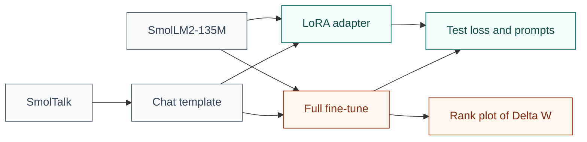

# LoRATune: instruction fine-tuning with low-rank adapters

This is a short lesson on Low-Rank Adaptation, then a worked run of that idea. The lesson reviews why a fine-tune can be written as a small update, what rank means, and how the two thin matrices $A$ and $B$ replace a full weight change. The worked run teaches [SmolLM2-135M](https://huggingface.co/HuggingFaceTB/SmolLM2-135M) to answer everyday chats from [SmolTalk](https://huggingface.co/datasets/HuggingFaceTB/smoltalk), once by updating every weight and once with a LoRA adapter. The method is Hu et al., [LoRA: Low-Rank Adaptation of Large Language Models](https://arxiv.org/abs/2106.09685) (2021).

The numbers and transcripts are from one finished run. They live in [`results/metrics.json`](results/metrics.json) and [`results/generations.md`](results/generations.md). Training was not repeated to write this page.

## What you should be able to explain

After this page you should be able to:

- Write a fine-tune as $W' = W + \Delta W$, and say what is frozen.
- Explain $\mathrm{rank}(\Delta W)$ as the number of independent directions that update is allowed to move in.
- Build $\Delta W$ from $A$ and $B$, including the shapes, the scale $\alpha / r$, and why $B = 0$ at the start.
- Write the training objective as next-token cross-entropy on every token in the conversation, and say that both runs minimize that same function.
- Read a test loss and a set of generated replies as two different checks on the same model.

## Review: fundamentals of LoRA

### Fine-tuning is an update, not a new model

A pretrained layer already computes $y = Wx$. Fine-tuning does not throw $W$ away. It learns a correction:

$$
W' = W + \Delta W, \qquad y = (W + \Delta W)\, x.
$$

$W$ is the pretrained matrix. $\Delta W$ is the task-specific change. If every entry of $\Delta W$ is free, that is full-model fine-tuning. For a 135M model that is 134,515,008 numbers, and most of them already know something useful.

Parameter-efficient fine-tuning keeps $W$ frozen and learns a smaller correction. LoRA is one way to do that. It bets that the useful correction lives in a few directions.

### Rank is the number of directions

The rank of a matrix is how many independent columns it has. A rank-1 matrix is one direction, copied at different scales. A rank-2 matrix is a plane: every column is a mix of two directions.

Take a 4 × 3 update, so 3 input features can change 4 outputs. A full update has 12 free numbers. A rank-1 update does not. Pick one output direction and one set of input weights:

$$
B =
\begin{bmatrix}
1 \\ 0 \\ -1 \\ 2
\end{bmatrix},
\qquad
A =
\begin{bmatrix}
1 & 2 & 0
\end{bmatrix},
\qquad
BA =
\begin{bmatrix}
1 & 2 & 0 \\
0 & 0 & 0 \\
-1 & -2 & 0 \\
2 & 4 & 0
\end{bmatrix}.
$$

Every column of $BA$ is a multiple of $(1, 0, -1, 2)^\top$. The matrix has one independent column, so $\mathrm{rank}(BA) = 1$. That is the largest rank a product $BA$ can have when the inner dimension is 1. In general,

$$
\mathrm{rank}(BA) \le r.
$$

In the forward pass this is easier to see:

$$
\Delta W\, x = B(Ax).
$$

- $Ax$ turns the input into $r$ numbers. Those numbers say how much of each learned direction this input should trigger.
- $B$ turns those $r$ numbers into the output. The change always lies in the column space of $B$.

With $r = 1$ and the matrices above, every input produces the same output shape, only larger or smaller. Output 2 cannot move, because that row of $B$ is 0, and output 1 cannot rise while output 4 falls, because they share one scale. With $r = 2$ the change can sit in a plane. Full fine-tuning can point anywhere in all $d_{\mathrm{out}}$ dimensions.

### The LoRA factorization

LoRA writes the correction as a product of two thin matrices, then scales it:

$$
\Delta W \approx s\, BA, \qquad s = \frac{\alpha}{r},
$$

$$
A \in \mathbb{R}^{r \times d_{\mathrm{in}}}, \qquad
B \in \mathbb{R}^{d_{\mathrm{out}} \times r}, \qquad
r \ll d_{\mathrm{in}}, \; r \ll d_{\mathrm{out}}.
$$

Two readings of "the update is low-rank" are easy to mix up.

1. Measured after the fact. Fine-tune all of $W$, then look at $\Delta W = W_{\mathrm{finetuned}} - W_{\mathrm{pretrained}}$. Sometimes that difference is close to a rank-8 or rank-16 matrix: a few singular directions hold the energy. Sometimes it is not. This is an observation about one model and one task.
2. Enforced while training. Never form a full $\Delta W$. Store and train only $A$ and $B$, so every step already satisfies $\mathrm{rank}(\Delta W) \le r$. This is what LoRA does. The claim is practical: training inside that thin family often reaches nearly the same task loss as updating every entry.

This project does both. The rank plot is reading 1, applied to the full fine-tune. The adapter run is reading 2.

### How the layer is initialized

$A$ is drawn at random. $B$ is set to the zero matrix. Then $BA = 0$, so on the first step

$$
y = Wx + s(BA)x = Wx.
$$

The wrapped layer matches the original layer exactly. Training only has to learn the change. If both matrices started random, the pretrained model would be jolted before it had seen a single conversation.

$\alpha$ does not add a new direction. It rescales the ones already chosen by $r$. In the recorded run $r = 8$ and $\alpha = 16$, so $s = 2$. A larger rank adds directions. A larger $\alpha$ makes those directions louder.

The forward pass is the same formula, written so the shapes stay obvious:

$$
y = W_{\mathrm{base}} x + \frac{\alpha}{r}\, (x A^{\top}) B^{\top}.
$$

$x A^{\top}$ compresses each token from $d_{\mathrm{in}}$ numbers down to $r$ numbers. Multiplying by $B^{\top}$ expands those $r$ numbers back to $d_{\mathrm{out}}$. The result has the same shape as $W_{\mathrm{base}} x$.

Only parameters whose names end in $A$ or $B$ are allowed to change. Everything else, including the original $W$, stays frozen.

### Where the adapter is attached

LoRA does not have to wrap every linear layer. The usual place is attention, because that is where the model chooses what to read from the context. This run wraps four projections in every layer:

- `q_proj`, the query
- `k_proj`, the key
- `v_proj`, the value
- `o_proj`, the attention output

The MLP layers stay frozen. That choice is why 134,515,008 trainable numbers fall to 921,600, about 0.7% of the model.

## The worked example

SmolLM2-135M was pretrained to predict the next token. It was not trained to take a user turn and answer it. On a chat prompt it usually copies the question.

Instruction tuning keeps the pretraining objective and changes the text that objective is summed over. Each SmolTalk conversation is one string. User and assistant turns share boundary tokens:

```text
<|im_start|><|user|>: hi there!<|im_end|>
<|im_start|><|assistant|>: hi, how is it going?<|im_end|>
```

### The loss function

The objective is next-token cross-entropy. At each position the model produces a distribution over the vocabulary, and the loss charges the log probability of the token that actually comes next:

$$
L = -\frac{1}{\lvert T \rvert}\sum_{t \in T}\log p(x_t \mid x_{\lt t}).
$$

$T$ is the set of scored positions. The label at each position is a copy of the token id, so $T$ contains every token in the formatted conversation: the user turn, the boundary tokens, and the assistant turn. Pad positions show up only when several conversations share a batch. Those positions are labeled -100 and stay out of $T$.

Both the full fine-tune and the LoRA run minimize this same $L$. AdamW steps on every weight in the full run, and only on $A$ and $B$ in the LoRA run.

The train split has 2,260 conversations. The test split has 119, and those 119 are never used to update weights. The training loss printed each epoch is the average of $L$ over the batches in that epoch. Inside a batch, $L$ is the mean over the real tokens, so a longer conversation contributes more tokens to that batch. The test loss later on this page is different: each of the 119 conversations is scored alone, and the reported number is the mean of those 119 values, so a short chat and a long chat count equally.

Two runs share that data and that template.

- Full fine-tune. AdamW, learning rate $\eta = 5 \times 10^{-5}$, batch size 4, 3 epochs, sequences truncated at 512 tokens. Every weight can move. Training loss by epoch: 0.924, 0.679, 0.516.
- LoRA. Rank $r = 8$, scale $\alpha = 16$, learning rate $\eta = 10^{-4}$, batch size 1, 3 epochs, on the query, key, value, and output projections. The learning rate is larger because only the thin matrices move. Training loss by epoch: 1.082, 0.973, 0.920.

## Technical design

One base model, one dataset, three services. They share the chat template and the test set. They do not share a training bill. Cost here is parameter state and updates per epoch, not a dollar price.


| Service | What moves | Trainable weights | Updates / epoch | Optimizer state | Artifact | Test loss |
| --- | --- | ---: | ---: | --- | --- | ---: |
| Base | nothing | 0 | 0 | none | public checkpoint | not scored |
| LoRA adapter | $A$ and $B$ only | 921,600 (0.7%) | 2,260 | AdamW on the adapter | `lora_adapters.pt` | 1.045 |
| Full fine-tune | every weight | 134,515,008 | 565 | AdamW on the whole model | full checkpoint | 0.883 |

Float32 weights for the 135M model are about 540 MB. AdamW keeps two extra copies of each trained parameter, so the full service carries roughly 2 GB of parameter state before activations. The LoRA service still loads those frozen weights, but the trained state is about 14 MB: the 921,600 adapter values, their gradients, and the two Adam moments. The full service takes fewer steps because its batch is 4. Each of those steps is the expensive one.

| | Base | LoRA | Full fine-tune |
| --- | --- | --- | --- |
| Learning rate | — | $\eta = 10^{-4}$ | $\eta = 5\times 10^{-5}$ |
| Batch | — | 1 | 4 |
| Epochs | — | 3 | 3 |
| Where it attaches | — | $W_q, W_k, W_v, W_o$ | every matrix |
| Best when | you only need the pretrained model | you can spend a small adapter for most of the gain | you can pay for the last 0.16 of test loss |



Teal is the cheap path. Rust is the expensive path. Slate is shared and not trained.

| Module | Service it belongs to | Responsibility |
| --- | --- | --- |
| `template.py` | shared | one chat string for every service |
| `data.py` | shared | load SmolTalk, tokenize, pad |
| `lora.py` | LoRA | $A$, $B = 0$, inject, freeze, save, load |
| `train.py` | LoRA and full | the two update rules |
| `evaluate.py` | shared | test loss and the 10 prompts |
| `analysis.py` | full fine-tune | $\|\Delta W - \Delta W_r\|_F$ |
| `scripts/train_lora.py` | LoRA | writes the adapter only |
| `scripts/train_full.py` | full fine-tune | writes the whole checkpoint |
| `scripts/evaluate.py` | shared | scores either artifact |
| `scripts/analyze_rank.py` | full fine-tune | redraws the rank plot |

`LoRALinear` is the teal service in one layer: random $A$, $B = 0$, and $W_{\mathrm{base}} x$ plus the scaled update. The adapter file is the pair $(A, B)$, not a second copy of SmolLM2.

## Check the idea: evaluation

The review says a rank-8 update can be enough. These two checks ask whether it was enough here. They answer different questions. Test loss asks whether the model predicts the reference conversations. The prompt suite asks whether a new question gets an on-topic reply. A model can improve one without fully fixing the other.

### Test loss

Each of the 119 test conversations goes through the same chat template as training and is scored with the same $L$ defined above. The batch size is 1, so there is no padding and $T$ is the whole conversation. The reported value is the mean of those 119 losses. Lower is better.

| Run | Test loss |
| --- | ---: |
| Full fine-tune | 0.883 |
| LoRA, rank 8 | 1.045 |
| Same LoRA adapter loaded again | 1.045 |

Read the table against the review. The full update is less surprised by the reference chats. The adapter, with 0.7% of the weights, lands about 0.16 higher, and saving then reloading $A$ and $B$ reproduces that number. The loss does not say that one generated sentence is helpful. The base model was not scored this way in the saved run, so there is no third number.

### Prompt suite

The same 10 user prompts, the same template, and a cap of 50 new tokens are run on the base model, the full fine-tune, and LoRA. This is not a numeric grade. A reply counts as addressing the question when the first assistant span does the thing that was asked. Three failures show up, and each one is a different kind of miss:

- copying the question, sometimes as a numbered list
- answering, then looping the same sentence
- answering a different question

Across the 10 prompts, using that rule on the first assistant span:

- Base model: **0 of 10.** It has the features, but no chat update. Nine prompts are copied or lightly reworded. The Inception prompt turns into a price fragment instead of a recommendation.
- Full fine-tune: **7 of 10.** Photosynthesis, pasta ingredients, the apology, the hike list, sleep, chicken and rice, and declining a party are on the asked topic. The movie prompt never names another film. The out-of-office prompt writes a hobby email. The offside explanation is wrong.
- LoRA: **3 of 10.** Photosynthesis, the apology, and falling asleep are on topic. The other seven miss, drift, or repeat the question.

That is the practical reading of $r = 8$. The adapter is enough to leave pure copying on a few questions. It is not enough to hold a longer or more factual answer as often as the full update. The transcripts below are the evidence. The untrimmed decodes are in [`results/generations.md`](results/generations.md).

## Worked conversations

Each row starts with the user prompt. The other three cells are model responses: the first assistant span only, cut off at the end of that turn. Quotation marks mark words the model actually produced. A note after the quotation is a reading of that response, not more generated text.

| User prompt | Base response | Full fine-tune response | LoRA response |
| --- | --- | --- | --- |
| Prompt: Explain photosynthesis in one sentence. | Response: "1. Explain photosynthesis in one sentence. 2. Explain the process of photosynthesis in one sentence." The model copies the prompt. | Response: "Photosynthesis is the process of using sunlight to make food for plants." | Response: "photosynthesis is the process by which plants convert sunlight, water, and carbon dioxide into energy and plant growth." |
| Prompt: Give me a simple pasta recipe for two people. | Response: "1. Give me a simple pasta recipe for two people." Repeated. | Response: "1/2 cup pasta sauce, 1/2 cup olive oil, 1/2 onion, chopped..." Ingredients only, no steps. | Response: "100 grams of pasta is 100 grams of pasta." |
| Prompt: How do I apologize to a friend after forgetting their birthday? | Response: "1. How do I apologize to a friend after forgetting their birthday?" Repeated. | Response: "I'm sorry I forgot your birthday." Then: "I'm sorry I'm not your friend anymore." | Response: "I'm sorry I forgot to include you in a birthday party." |
| Prompt: What should I pack for a weekend hike? | Response: "1. What should I pack for a weekend hike?" Repeated. | Response: "1. Water bottle, 2. Non-perishable food, 3. Flashlight, 4. A first aid kit..." The list then repeats. | Response: "10–15 miles per day." This answers a distance question, not the prompt. |
| Prompt: Recommend a movie if I liked Inception. | Response: "1.25x the price of a movie." Then asterisks. | Response: "1. Inception is a classic film." The same claim repeats. No second movie. | Response: "1986's Inception is a classic movie that has stood the test of time." No second movie, and the year is wrong. |
| Prompt: Help me write a short out-of-office email. | Response: "I'm a little confused about this. I'm not sure if I'm supposed to be a assistant..." | Response: "Write a short email to a friend or family member about a new hobby or interest." A different task from the prompt. | Response: "10:10:00 EDT - 10:10:50 US - 10:10:50 US..." Clock times, not an email. |
| Prompt: What is a good way to fall asleep faster? | Response: "1. What is the best way to fall asleep faster?" The prompt, lightly reworded and repeated. | Response: "Try to go to bed at the same time every night, even on weekends." Then a routine and avoiding screens. | Response: "A good way to fall asleep faster is to read a book or magazine, or do some other relaxing activity." |
| Prompt: Explain the offside rule in soccer. | Response: "1. Explain the offside rule in soccer. 2. Explain the offside rule in basketball." The prompt, then other sports. | Response: "Offside is when a player is on the ground or in front of the ball..." Not the actual rule. | Response: "The offside rule is a rule that allows a player to move their stick outside the playing area..." Not the actual rule. |
| Prompt: Suggest a weeknight dinner that uses chicken and rice. | Response: "1. Use a 100% rice substitute." Repeated. Does not answer the prompt. | Response: "1. Chicken breast, cooked and sliced. 2. Rice, 1 cup. 3. Garlic, minced. 4. Olive oil..." | Response: "10-15. What's your favorite dish?" Does not answer the prompt. |
| Prompt: How can I politely decline a party invitation? | Response: "1. How can I politely decline a party invitation?" The prompt, repeated. | Response: "You can politely decline a party invitation by saying no..." Then "I don't want to," "I'm not sure," and "I don't like the invitation." | Response: "How can I politely decline a party invitation?" The prompt, copied back. |

## Check the low-rank assumption

The figure is reading 1 from the review. Take the full fine-tune and form $\Delta W = W_{\mathrm{base}} - W_{\mathrm{full}}$. Its singular value decomposition is $\Delta W = U \Sigma V^{\top}$. Keeping the top $r$ singular values gives the best rank-$r$ approximation $\Delta W_r$, and the plotted quantity is the leftover:

$$
\| \Delta W - \Delta W_r \|_F = \sqrt{\sum_{i > r} \sigma_i^2}.
$$

Each panel is one projection. Darker lines are earlier layers. The vertical axis is that Frobenius norm.


The curves fall as $r$ grows, and they fall at different speeds. Some matrices are closer to low-rank than others. Later layers are not copies of earlier ones. That describes this full update. It does not prove that an adapter trained at $r = 8$ will match the full model. The test loss and the 10 prompts are that check, and they say rank 8 recovers part of the behavior, not all of it.

## Run the lesson yourself

```bash
pip install -r requirements.txt
python scripts/train_full.py --output outputs/full
python scripts/train_lora.py --output outputs/lora
python scripts/evaluate.py --model outputs/full
python scripts/evaluate.py --adapters outputs/lora/lora_adapters.pt --prompts
python scripts/analyze_rank.py --finetuned outputs/full --output outputs/rank_reconstruction.png
```

Checkpoints stay on disk. Nothing in this repository logs into Hugging Face or uploads a model. A new run will not match the recorded losses exactly: the training loader shuffles the 2,260 conversations.
