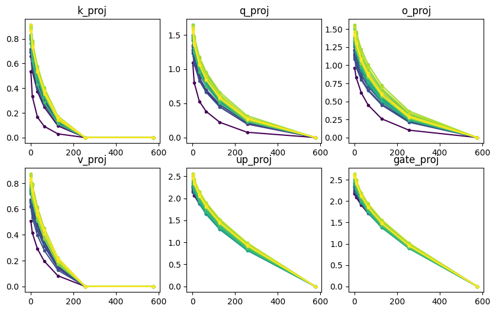
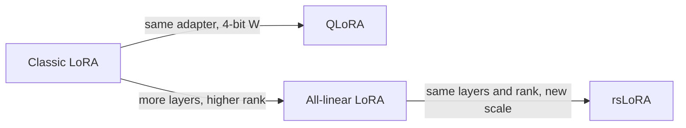
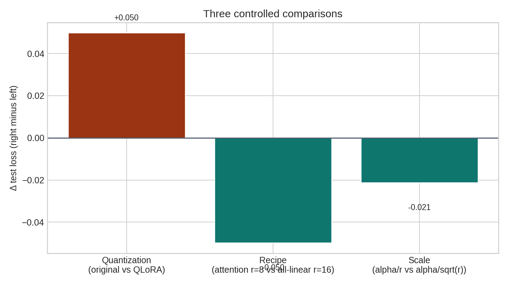
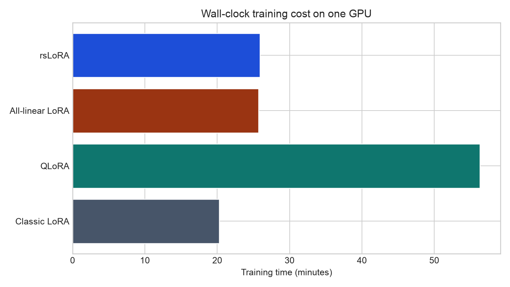

# LoRA Lens: four PEFT recipes on one chat task

Fine-tuning a language model usually means updating every weight. That works, but it is expensive: every parameter needs gradients and optimizer state, checkpoints balloon, and each new task tends to get its own full copy of the model. **LoRA** (Low-Rank Adaptation) is a parameter-efficient fine-tuning (PEFT) method that freezes the pretrained weights and trains only a small pair of low-rank matrices on selected layers. The idea is that the task update itself often lives near a low-rank subspace, so a thin adapter can absorb most of the benefit of a full fine-tune at a fraction of the trainable size.

**LoRA Lens** walks through four production-style LoRA variants—**classic LoRA**, **QLoRA**, **all-linear LoRA**, and **rsLoRA**—on one instruction-tuning / chat setup. Same base model ([SmolLM2-135M](https://huggingface.co/HuggingFaceTB/SmolLM2-135M)), same everyday-conversation instruction data ([SmolTalk](https://huggingface.co/datasets/HuggingFaceTB/smoltalk) `everyday-conversations`, 2,260 train / 119 test), same next-token loss, same ten prompts, one GPU run. The goal is to make the *conceptual* differences sharp, then show where they show up in test loss, memory, wall-clock time, and generated replies.

Papers: Hu et al., [LoRA](https://arxiv.org/abs/2106.09685) (2021); Dettmers et al., [QLoRA](https://arxiv.org/abs/2305.14314) (2023); Kalajdzievski, [rsLoRA](https://arxiv.org/abs/2312.03767) (2023). All-linear targeting is not a separate algorithm: it is LoRA with PEFT `target_modules="all-linear"`.

A full fine-tune of this 135M model updates **134,515,008** parameters. The adapters below train between 0.92M and 4.88M—about 0.7% to 3.6% of that full count—while a separately recorded full update reaches test loss 0.883 and 7 / 10 prompts. That full run is the dense reference the PEFT recipes are measured against.

## A gentle introduction to LoRA

Every recipe freezes the pretrained weights $W$ and trains a low-rank update

$$
\Delta W \approx s\, BA, \qquad
A \in \mathbb{R}^{r \times d_{\mathrm{in}}}, \qquad
B \in \mathbb{R}^{d_{\mathrm{out}} \times r}.
$$

The **rank** $r$ is the bottleneck width: it is how many free directions the adapter is allowed to use. The **scale** $s$ stretches or shrinks the update before it is added back onto the frozen layer. $A$ starts random. $B$ starts at zero, so the wrapped layer equals $Wx$ on step 0 and training does not jump the pretrained behavior. The forward pass is

$$
y = W_{\mathrm{base}} x + s\, (x A^{\top}) B^{\top}.
$$

That factorization is the whole point: instead of a dense $`d_{\mathrm{out}} \times d_{\mathrm{in}}`$ update, you store and train two thin matrices whose product has at most rank $r$.

Why is a low-rank update plausible at all? After a full fine-tune, form $`\Delta W = W_{\mathrm{base}} - W_{\mathrm{full}}`$. The leftover of the best approximation of rank $r$ is

$$
\| \Delta W - \Delta W_r \|_F = \sqrt{\sum_{i > r} \sigma_i^2}.
$$



The curves fall as $r$ grows, at different speeds for different projections. That motivates low-rank adapters. It does not by itself choose attention-only rank 8 over all-linear rank 16; the scorecard later is that choice.

The training objective here is next-token cross-entropy on the full chat string (user turns, boundary tokens, assistant turns):

$$
L = -\frac{1}{\lvert T \rvert}\sum_{t \in T}\log p(x_t \mid x_{\lt t}).
$$

Test loss is the mean of $L$ over the 119 held-out conversations, each scored alone. The prompt suite uses the same ten user turns, greedy decoding, and a 50-token cap. A reply counts as addressing the question when the first assistant span does what was asked.

## Comparing the four recipes

The four recipes share the same $BA$ math. They differ in how $W$ is stored, which layers get $A$ and $B$, what rank $r$ is, and how the scale $s$ is defined.

| Method | Idea in one line | This run |
| --- | --- | --- |
| **Classic LoRA** | Low-rank adapters on attention only | $`r = 8`$, $`\alpha = 16`$, $`s = \alpha/r`$, targets `q,k,v,o`, float $W$ |
| **QLoRA** | Same adapters, 4-bit frozen base | Same adapter as classic; NF4 + double quant for $W$ |
| **All-linear LoRA** | Adapters on every linear layer in the block | $`r = 16`$, $`\alpha = 16`$, $`s = \alpha/r`$, attention + MLP |
| **rsLoRA** | Rank-stabilized scale on that wider adapter | Same layers and rank as all-linear; $`s = \alpha/\sqrt{r}`$ |



### Classic LoRA

Hu et al. write the task update as a product of two thin matrices and train only those matrices. In the original paper the usual place to attach them is attention. This run follows that pattern: wrap `q_proj`, `k_proj`, `v_proj`, and `o_proj` in every layer, leave the MLP frozen, use $`r = 8`$ and $`s = \alpha / r = 2`$. Trainable count: **921,600** parameters—about 0.7% of the **134,515,008** weights a full fine-tune would update.

This is the baseline. The other three runs each change one design choice relative to a neighbor in the diagram above.

### QLoRA

Dettmers et al. keep the same LoRA math and change how the frozen base is stored. $W$ lives in 4-bit NormalFloat (NF4), often with double quantization. Gradients still flow into $A$ and $B$ in higher precision. The point is memory: a 7B or 70B model that will not fit in float16 can still take an adapter.

This run keeps the **exact classic adapter** (attention only, $`r = 8`$, $`\alpha = 16`$, $`s = \alpha/r`$) and only switches the base to NF4. Any gap versus classic LoRA is the cost of quantization, not a change in rank or targets.

### All-linear LoRA

This is still LoRA. Hugging Face PEFT exposes it as `target_modules="all-linear"`: every `Linear` module except the output head. On a Llama-style block that is

`q_proj`, `k_proj`, `v_proj`, `o_proj`, `gate_proj`, `up_proj`, `down_proj`.

Production configs often combine that target list with a modest rank such as 16. This run uses $`r = 16`$, $`\alpha = 16`$, and $`s = \alpha / r = 1`$. Trainable count: **4,884,480** parameters. Compared with classic LoRA, both the **layers** and the **rank** change, so the gap is the whole recipe, not a single knob.

### rsLoRA

Kalajdzievski argues that $`s = \alpha / r`$ shrinks the update as rank grows, which can hide the benefit of a larger $r$. Rank-stabilized LoRA sets

$$
s = \frac{\alpha}{\sqrt{r}}.
$$

At $`r = 16`$ and $`\alpha = 16`$, classic scaling gives $`s = 1`$ and rsLoRA gives $`s = 4`$. This run keeps the all-linear target list and $`r = 16`$, and only flips the scale (PEFT `use_rslora=True`). Any gap versus all-linear LoRA is the scale alone.

## Shared training setup

| Setting | Value |
| --- | --- |
| Base model | SmolLM2-135M |
| Dataset | SmolTalk `everyday-conversations` (instruction / chat) |
| Optimizer | AdamW, $`\eta = 10^{-4}`$ |
| Batch size | 1 |
| Epochs | 3 |
| Max length | 512 |
| Seed | 42 |
| Library | Hugging Face Transformers + PEFT (+ bitsandbytes for QLoRA) |

## Results

### Scorecard

| Method | Trainable params | Share of full FT | Frozen base memory | Train time | Epoch-3 train loss | Test loss | Prompts addressed |
| --- | ---: | ---: | ---: | ---: | ---: | ---: | ---: |
| Full fine-tune (reference) | 134,515,008 | 100% | ~540 MB | — | — | **0.883** | **7 / 10** |
| Classic LoRA | 921,600 | 0.7% | 517 MB | 20.3 min | 1.017 | **1.041** | **6 / 10** |
| QLoRA | 921,600 | 0.7% | 39 MB | 56.3 min | 1.066 | **1.091** | **4 / 10** |
| All-linear LoRA | 4,884,480 | 3.6% | 532 MB | 25.7 min | 0.934 | **0.991** | **6 / 10** |
| rsLoRA | 4,884,480 | 3.6% | 532 MB | 25.9 min | 0.853 | **0.970** | **6 / 10** |

The full fine-tune row is a separately recorded dense update of the same model and data—a ceiling for quality, not a fifth PEFT recipe in this session.


All four adapters land above the full fine-tune line. Classic LoRA and QLoRA sit near 1.04–1.09; widening the adapter (all-linear, then rsLoRA) pulls test loss down toward—but not onto—the full-update reference. On this 135M chat task, PEFT closes much of the gap without matching a dense update.


The training curves tell the same story earlier: rsLoRA drops fastest and finishes lowest (0.853 at epoch 3), then all-linear (0.934), classic (1.017), and QLoRA (1.066). Quantization slows fitting; a wider adapter and a larger effective scale speed it up. None of the curves diverge wildly, so the ranking at the end is a smooth continuation of the ranking mid-run.

### Three controlled readings

Do not rank the four methods with one number. Read them as three pairs.



**Classic LoRA versus QLoRA (quantization).**  
Same adapter. Test loss rises from 1.041 to 1.091 ($`\Delta = +0.050`$). Prompts addressed fall from 6 / 10 to 4 / 10. Frozen weight memory falls from about 517 MB to about 39 MB. Training time roughly triples (20 min → 56 min) on this GPU, which is the bitsandbytes path paying for dequantization during the forward/backward. On this 135M model the memory win is large and the quality tax is clear—exactly the QLoRA trade in miniature. For a model that already fits in float, classic LoRA is the better default; for a model that does not, QLoRA is the reason the run can happen at all.

**Classic LoRA versus all-linear LoRA (targets and rank).**  
Attention-only rank 8 against every linear layer at rank 16. Test loss falls from 1.041 to 0.991 ($`\Delta = -0.050`$). Prompt count stays 6 / 10. Trainable parameters grow from 0.92M to 4.88M, and wall-clock rises only modestly (20 → 26 min). The wider recipe fits the reference chats better; the small prompt suite does not separate them by count, but the *which* prompts succeed does shift (see below). Treat this gap as a whole-recipe change: both coverage and rank moved together.

**All-linear LoRA versus rsLoRA (scale).**  
Same layers, same rank, same $\alpha$. Test loss falls from 0.991 to 0.970 ($`\Delta = -0.021`$). Prompt count stays 6 / 10. Final training loss falls from 0.934 to 0.853. At $`r = 16`$, $`\alpha/\sqrt{r}`$ uses the extra capacity more effectively than $`\alpha/r`$. That is a cheap win: no extra parameters, no extra layers—only a different multiplier on the same $BA$ product.




The params-vs-loss scatter separates two clusters: the 0.92M attention adapters (classic / QLoRA) and the 4.88M all-linear adapters (all-linear / rsLoRA). Inside each cluster, storage of $W$ and the scale $s$ decide the rest. Memory is almost entirely a QLoRA story. Time is dominated by QLoRA as well; among float-base runs, the wider adapters cost a few extra minutes, not a new order of magnitude.

### Takeaways

- **rsLoRA** has the best test loss of the four (0.970), still above the full fine-tune reference (0.883).
- **Widening the adapter** (all-linear, higher rank) helps next-token fit more than **quantizing the base**.
- **QLoRA** is the memory method: same adapter size as classic LoRA, much smaller frozen $W$, weaker loss and prompts here.
- Three methods sit at 6 / 10 on the prompt suite, so loss carries the ranking and the transcripts show which prompts flip.

## Prompt and answer differences

Hand labels from [`prompt_scores.csv`](results/four_methods_bundle/prompt_scores.csv):

| Method | Addressed | On-topic prompts |
| --- | ---: | --- |
| Classic LoRA | 6 / 10 | Photosynthesis, apology, hike, out-of-office tips, sleep, decline |
| QLoRA | 4 / 10 | Photosynthesis, apology, sleep, decline |
| All-linear LoRA | 6 / 10 | Photosynthesis, apology, hike, sleep, chicken and rice, decline |
| rsLoRA | 6 / 10 | Photosynthesis, pasta ingredients, apology, hike, chicken and rice, decline |

Loss and prompt count can agree while the *content* of the first assistant span still diverges. Quotes below are the recorded `first_assistant_span` strings from [`generations.csv`](results/four_methods_bundle/generations.csv) (truncated where long).

**Pasta for two.** Classic LoRA echoes the user turn (`2000-2001: Give me a simple pasta recipe for two people.`). QLoRA drifts into risotto (`What's the difference between a pasta and a risotto?` …). All-linear invents a nonsense pasta-water list (`1.1 cups pasta water, 1.2 cups pasta water, …`). Only rsLoRA lands an ingredient-style answer (`1/2 cup pasta sauce, 1/2 cup grated Parmesan cheese, 1/2 cup chopped fresh basil, …`). Same prompt scoreboard slot for three methods can still hide a clear qualitative win for rsLoRA here.

**Weekend hike.** Classic and all-linear both produce packing lists (`Pack light, comfortable clothing…` / `Bring a water bottle, a snack, and a map or GPS.`). QLoRA collapses into weight nonsense (`1000-2000 pounds of weight for a weekend hike.`). rsLoRA stays on topic with a backpack of essentials, even if the day-count framing is odd (`You should pack a backpack with a full load of essentials like water, snacks, and a first aid kit.`).

**Fall asleep faster.** Classic and all-linear recommend a quiet dark room. QLoRA stays loosely on topic with a comfortable mattress. rsLoRA misses by talking about deep-sleep durations (`1.5-30 minutes of deep sleep is ideal for falling asleep.`) instead of a practical tip—an example where the best test-loss method still fails a specific prompt the weaker methods pass.

**Decline a party.** All four stay roughly on topic. Classic / all-linear: `Say "no" politely.` QLoRA: `Say "no" firmly and clearly.` rsLoRA: decline phrasing built from `I'm not sure` / `I don't know`. The success label is shared; the tone of the refusal still differs.

**Hard prompts across methods.** Movie recommendation rarely names a second film (classic: `Inception is a great movie.` looping; rsLoRA: `It's a sci-fi adventure film.` with no alternative title). Out-of-office often turns into meta-instructions or confusion (rsLoRA: `I'm a bit confused about the difference between a letter and a letter of the alphabet.`). Offside explanations stay wrong for every recipe (e.g. classic: `Offside is when a player is in the other team's half of the field, and the ball is in play.`). Full spans live in the CSV.

## Reproduce

Four-method comparison (CUDA GPU recommended; QLoRA needs bitsandbytes):

```bash
pip install -r requirements.txt
python scripts/train_four_methods.py --output results/four_methods_run
```

This writes metrics, training curves, generations, adapters, and figures under the output directory. The checked-in bundle under `results/four_methods_bundle/` is the recorded reference run—do not overwrite it unless you intend to replace the article numbers.

Colab alternative: open [`notebooks/FourMethods_Colab.ipynb`](notebooks/FourMethods_Colab.ipynb), mount Drive, and run top to bottom. The notebook imports the same package helpers; `scripts/train_four_methods.py` is the source of truth locally.

Single classic adapter or full fine-tune:

```bash
python scripts/train_full.py --output outputs/full
python scripts/train_lora.py --output outputs/lora
python scripts/evaluate.py --model outputs/full
python scripts/evaluate.py --adapters outputs/lora/lora_adapters.pt --prompts
```

Checkpoints stay on disk. Nothing in this repository logs into Hugging Face or uploads a model. A new run will not match these losses exactly: the training loader shuffles the 2,260 conversations.
